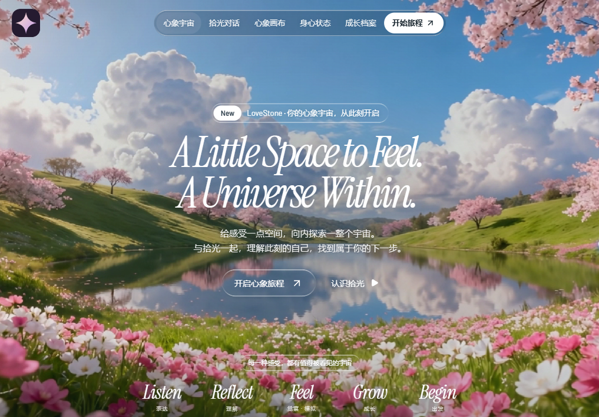
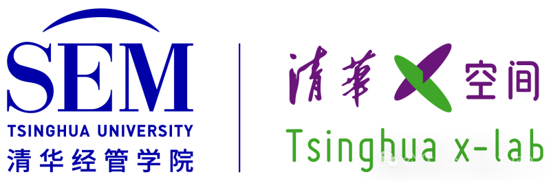
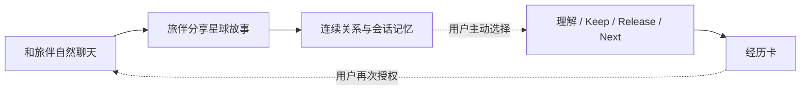

# 清华-腾讯S-Makers向善创客计划青少年心理平台\*翎语

[打开官网体验（当前为静态演示）](https://qsinghua.lingozm.cn/)

  
  &nbsp;&nbsp;
  

> 这个世界从不缺少问题，缺少的是愿意用最好的工具去解决它们的优秀人才。

## 项目介绍

**翎语** 是一个面向个人的 Personal Emotional Agent。它的主入口是一位来自未知星球的旅伴：用户可以像和朋友一样连续聊天，听旅伴主动讲述自己的家庭、学校和社会，也可以随时停下、转话题或问一个关于星球的小问题。理解、纠正、Keep / Release / Next 和经历卡是可选的支持能力，服务于关系与成长，不把每轮对话变成分析报告。

心象宇宙是这套机制的交互载体。静水湾、涟漪、光点和成长档案不是装饰，而是把四个关键动作变成可见反馈：

### 核心创新：来自未知星球的旅伴

翎语把“观念 B 影响观念 A”的支持过程，放进一个更亲和、更有故事的心象宇宙里。每一位 Personal Agent 都是从一颗未知星球降临的旅伴：他们有自己的名字、家庭、学校、社会和价值观，带着一套温柔但有边界的生活经验，和用户在日常对话里慢慢成为朋友。

当前前端演示提供三位可选择的旅伴：拾光（云岚星）、未蓝（弦月环）和栖雨（潮汐森）。用户可以查看每位旅伴的家庭、学校、社会故事，理解他们为什么这样看待“失败、需要、节奏和下一步”，再邀请其中一位降临。邀请动作会把旅伴的开场语气带入对话；后续真实产品将把已授权的角色设定、用户确认的理解与故事上下文交给 Personalization & Evaluation Engine，共同形成可回看的支持旅程。

这里的故事是支持的共同语言，不是用剧情替代真实帮助。旅伴不会替用户下诊断或强行改变用户；需要时才打开的 AI 理解仍是可修改、待确认的假设，Keep / Release / Next 仍由用户决定。真实模型通过独立的自然聊天路由接入，缺少后端 Key 时官网仍保持明确标注的静态演示。

### 我们真正的产品亮点

- **理解权在用户手里**：AI 输出的是待确认假设，不是诊断；四个字段可以逐栏修改、留空和确认。
- **支持形成闭环**：Keep、Release、Next 不是三个装饰按钮，而是把理解转成用户自己的记录、放下或小行动。
- **记忆有边界**：聊天不会自动变成长期记忆。只有用户主动保存、明确允许未来参考的经历卡，才可能在下一次对话中被带入，而且每次发送前仍需单独授权。
- **个人数据按账号隔离**：产品 API 使用账号会话、CSRF/Origin 校验、版本令牌和用户命名空间；删除或撤回后，相关旧上下文会失效。
- **心象宇宙承载真实支持**：角色和场景会随“提议理解→用户确认→支持选择”变化，故事互动服务于自我表达和下一步行动，而不是单纯养成或剧情消费。
- **关系先于报告**：旅伴会保留当前会话里的称呼、话题和故事线索，并在下一轮自然接续；用户授权的经历卡可作为额外关系记忆带入，聊天界面不强迫用户先填写分析表。

### 一分钟演示路径

打开[官网静态演示](https://qsinghua.lingozm.cn/)，点击「开启心象旅程」：

1. 先在「旅伴对话」里选择一位来自未知星球的朋友，查看他的家庭、学校和社会故事，再点击「邀请降临」。
2. 直接输入一句今天想说的话，观察用户气泡与旅伴回应连续出现在同一段对话里。
3. 继续问旅伴关于星球、家人或学校的故事；每一轮都沿用当前会话，不再跳出分析报告。
4. 需要整理时，再打开“旅伴记下了这一刻”的可选理解层，使用 **Keep / Release / Next** 保存经历卡。
5. 产品服务部署后，登录用户可以选择把已保存卡片作为关系记忆带入下一轮。

官网当前是**静态演示**，因此不声称已经连接真实模型、账号或云端存储。完整产品 API、账号隔离、真实模型适配器和腾讯云单机部署配置都在本仓库中，可按[产品闭环说明](docs/product-loop.md)启动。

## 当前交付状态（2026-11-16）

官网目前部署在腾讯云 EdgeOne，提供电影感页面与独立演示。**尚无运行本项目的后端服务器，DeepSeek Key 尚未配置；官网暂未开放真实账号、模型对话或云端经历卡保存。** 本轮代码包含这些功能的产品 API、前端接入与部署文件；真实供应商联调和服务器上线仍待完成。静态官网的界面更新不等于 Python 服务已经上线。

| 能力 | 当前状态 |
|---|---|
| 心象宇宙、旅伴对话、心象画布、身心趋势、成长档案 | 前端可运行；无后端时使用明确标注的演示数据 |
| 旅伴连续聊天 → 主动讲故事 → 会话内关系记忆 | `/api/companion` 与前端聊天客户端已实现；真实 DeepSeek 调用需本地 Key 和运行中的产品后端 |
| 四字段理解 → 用户纠正 → 版本确认 → Keep / Release / Next → 经历卡 | 作为可选支持层保留，产品 API 与前端接入已实现，注入模型测试覆盖 |
| 注册登录、用户隔离、主动保存/删除经历卡、按次参考已授权卡片 | 后端代码已实现；需要部署产品服务后才能在线使用 |
| 个人多模态输入与可穿戴趋势 | 当前为模拟设备数据，需显式选择用途；真实硬件未接入 |
| 心理策略、专业安全评审、成熟的未成年人隐私流程 | 待完成；工程检查不代表心理效果或专业审核通过 |

运行步骤、接口与数据边界见 [产品闭环说明](docs/product-loop.md)，服务器准备及域名切换见 [腾讯云部署说明](docs/tencent-product-deployment.md)。最终自动检查结果以本轮交付记录为准；下文带日期的测试数字是历史记录。

本轮验收：后端 **685 项**、前端 **51 项**、类型检查及生产构建通过；官网新版静态演示已发布并逐项校验 46 个文件。真实供应商调用尚未执行：本机没有 `DEEPSEEK_API_KEY`，官网也没有可运行 Python 后端；代码路径已用注入模型完成自然聊天和幂等测试，详见 [交付与验证记录](docs/delivery-20261108.md)。

各分支和可复用模块的取舍见 [分支与交付基线评估](docs/branch-evaluation-20261116.md)。当前不整体合并 `origin/main` 的 LifeSnaps 分支，避免覆盖账号隔离和经历卡闭环；LifeSnaps 保留为下一阶段的授权可穿戴回放模块。

## 产品与演示范围

翎语是面向个人的情绪支持 Agent。心象宇宙把一次支持对话做成可回看的经历：用户说出发生了什么，与选中的星球旅伴一起核对理解，选择接下来想怎么照顾自己，再决定要不要留下一张经历卡。AI 理解是可以纠正的假设，不是诊断。

## 运行账号与真实模型产品框架

推荐 Python 3.12+、Node.js 22+。首次安装依赖后，在两个终端分别启动；本地始终使用相同的 `127.0.0.1` 主机名。

~~~powershell
py -3.12 -m venv .venv
.\.venv\Scripts\python.exe -m pip install -r requirements.txt
$env:PRODUCT_ORIGIN = 'http://127.0.0.1:3070'
$env:PRODUCT_COOKIE_SECURE = 'false'
$env:LLM_MAX_TOKENS = '1800'
.\.venv\Scripts\python.exe -B -m uvicorn app.product.main:create_app --factory --host 127.0.0.1 --port 8070 --workers 1
~~~

~~~powershell
cd frontend
npm ci
$env:LOVESTONE_PRODUCT_API_URL = 'http://127.0.0.1:8070'
npm run dev -- --port 3070
~~~

打开 [http://127.0.0.1:3070](http://127.0.0.1:3070)。模型调用还需在根目录 `.env` 配置 `DEEPSEEK_API_KEY`；Key 仅留在服务端，不上传 GitHub。缺少 Key 时注册和卡片管理仍可检查，真实对话会明确报配置缺失，不自动用脚本冒充模型回复。

产品入口仅使用 **一个 worker**，对话与设备数据保留在进程内；账号与用户主动保存的经历卡写入 SQLite。`app.main:app` 是原有本机工程入口，仅绑定回环地址，不用于公网代理。

## 运行前端演示

在仓库根目录执行（需要 Node.js 22 或以上，建议使用受支持的 LTS 版本）：

~~~powershell
cd frontend
npm ci
npm run dev
~~~

打开 [http://127.0.0.1:3000](http://127.0.0.1:3000)。默认演示不需要启动 Python 服务，也不需要 API Key。

1. 从心象宇宙首页选「开启心象旅程」，点「使用虚构示例」，再点输入框右侧箭头（生成理解草稿）。
2. 在对话页编辑事实、解释、情绪或需要，再点「确认当前理解」；也可去心象画布逐层回看。
3. 选择 Keep（留下）、Release（放下）或 Next（向前），主动「保存经历卡」；到成长档案检查结果。

未配置后端时，个人状态页显示固定模拟样本，演示经历卡仅在本页内存。产品服务部署后，登录用户可以主动保存账号所属的经历卡；聊天与设备数据不会随卡片自动持久化。每次模型调用需同意发送本轮内容，是否保存卡片、是否允许未来参考、当轮是否参考是分别控制的选择；Release 文本不写入经历卡。详见 [产品闭环说明](docs/product-loop.md)。

首页和四个用户内页各有独立的电影感场景：暗色旅伴对话、明亮心象画布、六段式身心状态、星空成长档案。背景循环播放，页面提供逐词渐显、滚动揭示、理解层切换、交互趋势与卡片展开；移动端使用折叠导航。外部视频加载期间或失败时显示本地海报；演示逻辑不依赖模型 API。

在 `frontend/` 运行 `npm run typecheck`、`npm test`、`npm run build` 验证前端。下文保留现有 Python 运行、测试与评测入口。

## Personal Emotional Agent 后端

面向团队比赛项目的 Agent 运行框架，提供文字与语音输入、会话管理、可纠正草稿和工程评测能力。

## 后端实现范围

本轮新增产品边界 **0.9.0**；模块 1—8 与原 Runtime 工程能力保留。下表的“已实现”指代码及工程验证，不表示官网已连接真实供应商。

| 模块 | 状态 | 已交付内容 |
|---|---|---|
| 心象宇宙前端 | 已实现 | 保留电影布局、四栏与经历卡；新增产品账号、逐次模型授权和跨会话参考控制；独立演示明确标注 |
| 旅伴自然聊天 | 已接入 | `/api/companion`、连续会话、旅伴世界提示词、已授权经历卡引用和请求幂等；真实 Key/服务器待配置 |
| 文字聊天与结构化支持 | 已完成 | DeepSeek API、多轮上下文、终端聊天与 FastAPI 消息接口；结构化理解作为可选层 |
| 会话与运行控制 | 已完成 | 创建、切换、结束、清空，执行状态、暂停确认演示、取消、超时、预算与请求去重 |
| 通用草稿 | 已完成 | 创建、编辑、拒绝、按版本确认，纠正后旧确认失效 |
| 上下文与来源 | 已完成 | 使用当前有效草稿，记录来源，排除依赖已作废草稿的旧回复 |
| 离线工程评测 | 已完成 | 14 条工程案例、批量运行、版本与环境记录、脱敏报告 |
| 本地保存与恢复 | 已完成 | 用户主动保存 SQLite 快照，支持恢复、删除、版本冲突检查与旧请求阻止重放 |
| 语音输入 | 已完成 | 浏览器录音、腾讯云 ASR、模拟流程、转写校对后发送，支持取消、去重与短期缓存清理 |
| 外部调用调度与预算 | 已完成 | DeepSeek 与 ASR 共享总并发，有限队列、供应商限额、排队与执行总时限、取消及脱敏用量统计 |
| 心理模块接口 | 工程接入完成，专业审核待完成 | 严格结构化输入输出、来源检查、四路线与独立故障通知；unreviewed |
| 心理业务流程 | 代码闭环已接入 | 模型四字段契约、用户编辑/确认、跨轮纠正、撤回失效与取消；真实模型联调、心理效果与专业审核待完成 |
| 穿戴及业务存档 | 模拟接入完成 | 30 指标契约、可复现模拟、用途授权、基线/趋势、显式 v2 保存与恢复；真实设备、案例引擎与独立效果评测待接 |
| 产品账号与经历卡 | 新增实现 | 用户名/密码登录、会话 Cookie、按用户隔离、主动保存/删除、未来参考授权；需部署产品服务后使用 |

业务状态当前保持 INITIAL。通用工程草稿继续使用 title/items；产品四字段是可修改、待确认的理解假设。CaseForge 属内部研发评测；B2B 为后续路线，均不是当前普通用户主产品。

产品服务采用 HttpOnly Cookie、7 天登录有效期、Origin/CSRF 检查与用户命名空间。SQLite 业务内容为明文文件，未实现端到端加密、邮箱找回或成熟的未成年人隐私流程；详见 [数据边界](docs/product-loop.md#数据与隐私边界)。原本机工程接口没有这些账号隔离措施。

## 历史交付与验证

以下保留原阶段记录，不作为本轮真实模型联通或当前官网后端上线的证据。

- **2026-11-05 · 原页面接入纠正**。撤掉新增页面壳和模式条，保留原设计并接业务。前端 **42 项测试、类型检查与生产构建通过**；原页对话、四栏确认、30 指标图表及经历卡已做浏览器验收，后端沿用上轮 615 项结果。没有真实设备或模型调用。

- **2026-11-05 · 持续支持流程与模块 8**。后端 **615 项测试通过**；前端新增持续会话、结构化结果、授权设备趋势与理解确认。真实模型和设备调用为零；固定脚本浏览器联调与构建验证另见 [协作说明](docs/frontend-support-integration.md)。

- **2026-11-04 · 翎语前端同步**。合入已完成的 Next.js 演示与品牌资料，保留 Runtime 0.6.0 的语音和调用调度。前端构建、类型检查与 8 项测试已通过；合并后重新运行后端 237 项测试及 14/14 离线工程评测，全部通过，未调用真实模型。
- **2026-11-04 · 统一调用调度**。两类调用共享资源上限，支持有限排队、公平调度与取消。GET /runtime/calls 提供受控编号、耗时、供应商返回的 token 用量和输入音频时长。设计与配置见 [调用调度说明](docs/call-scheduler.md)。
- **2026-11-04 · 语音输入**。新增 /voice 页面及语音状态、转写和取消接口。腾讯云用约 6.9 秒的虚构合成音频完成真实识别。浏览器使用模拟麦克风验证录音、校对后发送、取消和聊天响应丢失后的去重重试，桌面与移动宽度布局检查通过。
- **2026-11-03 · 心理接口草案**。交付字段类型、引用规则、错误处理约定和两条虚构联调用例。心理路线、示例预期与正式集成仍待团队评审。

上游 2026-11-04 的完整回归为 **237 项测试通过**，包括语音测试 30 项和调用调度检查 22 项，另有 **14/14 工程评测通过**。
完整回归环境为 Windows / Python 3.13.5，新增语音测试也在 Python 3.12.13 通过。心理质量与专业安全效果等待相应业务评审和评测。

模块记录见 [开发步骤与进度](docs/development.md)，语音操作见 [语音输入说明](docs/voice-input.md)，心理对接见 [心理模块接口草案](docs/psychology-interface.md)。

## 首次运行（Windows PowerShell）

在克隆下来的项目文件夹打开终端。文件夹可以位于任意磁盘、使用任意名称，无需修改源码路径。
请先安装 Python；本项目最近验证环境为 Python 3.13。

~~~powershell
py -3.13 -m venv .venv
.\.venv\Scripts\python.exe -m pip install -r requirements.txt
.\.venv\Scripts\python.exe -B -m app.cli --demo
~~~

如果没有 py 启动器，可用对应 Python 解释器运行 python -m venv .venv。
依赖安装完成后，离线演示不需要 API Key。

## 配置真实聊天

仅当项目内还没有 .env 时，从模板创建配置（已有 .env 时跳过复制，避免覆盖 Key）：

~~~powershell
Copy-Item .env.example .env
~~~

在本地 .env 的 DEEPSEEK_API_KEY 后填写自己的 Key，或用交互输入：

~~~powershell
.\.venv\Scripts\python.exe -B -m app.cli --configure
.\.venv\Scripts\python.exe -B -m app.cli
~~~

Key 只保存在本地。配置不上传仓库，不把 Key 放进命令参数或共享文档。
--check 仅检查配置是否存在，不代表认证、额度或服务已验证。

## 常用命令

在项目根目录运行：

~~~powershell
.\.venv\Scripts\python.exe -B -m app.cli --offline
.\.venv\Scripts\python.exe -B -m app.cli --draft-demo
.\.venv\Scripts\python.exe -B -m app.cli --context-demo
.\.venv\Scripts\python.exe -B -m app.cli --archive-demo
.\.venv\Scripts\python.exe -B -m app.evaluation
.\.venv\Scripts\python.exe -B -m pytest -q -p no:cacheprovider
.\.venv\Scripts\python.exe -B -m uvicorn app.main:app --reload --host 127.0.0.1 --port 8000
~~~

API 文档：[http://127.0.0.1:8000/docs](http://127.0.0.1:8000/docs)。已有服务时不用重复启动。
语音页面：[http://localhost:8000/voice](http://localhost:8000/voice)。支持模拟流程和腾讯云真实转写，文字校对后发送。
录音、配置与接口见 [语音输入说明](docs/voice-input.md)。
Windows 也可用 .\dev.ps1 -Mode demo / chat / api / test / eval / archive-demo / check / setup。
若 PowerShell 限制执行脚本，直接使用上面的 Python 命令。

macOS/Linux 对应使用 python3 创建虚拟环境，并将解释器路径替换成 .venv/bin/python。
本轮未在 macOS/Linux 上验证。

## 聊天中的操作

- /new、/sessions、/use 编号前缀：新建、查看与切换会话。
- /history、/status、/context、/events：查看历史与运行元数据。
- /demo、/confirm、/cancel：演示流程的等待、确认与取消。
- /draft-new 标题、/draft-edit 标题、/draft-confirm、/draft-reject：通用草稿操作。
- /save、/archives、/restore 编号前缀：主动保存、列出和恢复。
- /save 存档版本：更新快照；/archive-delete 编号前缀 存档版本：删除快照。
- /clear 清空当前内存，磁盘存档保留；/end 结束；/exit 退出。

完整命令见 /help。修改代码后需重新打开终端聊天。

## 路径与个人配置

| 内容 | 默认位置 |
|---|---|
| API Key 与模型配置 | 项目根目录 .env |
| 评测案例 | evaluation/cases/runtime_v1.json |
| 评测报告 | 项目根目录 reports/ |
| 主动保存的会话 | data/session-archives.sqlite3 |
| 团队说明 | docs/ |

以上位置随项目移动。会话默认内存，只有主动保存才写入数据库。
启动或只列出空存档不创建数据库。恢复不重放旧请求，不恢复旧确认凭据。
本节路径对应原本机工程入口：它用于本机单用户开发，没有产品账号隔离；本地存档为明文文件。产品入口的账号与经历卡位于 `PRODUCT_DATA_DIR`（默认 `data/product`），其运行边界见 [产品说明](docs/product-loop.md)。

需要把报告放入自己的笔记目录时，复制 local.paths.example.json 为 local.paths.json，
设置 evaluation_output_dir 为个人路径。相对路径以项目根目录为基准。
local.paths.json 已被 Git 忽略，不会把个人路径带给队友。
harness_note 仅供本机开发者定位原始研究笔记，程序不执行其中内容。

报告路径优先级：命令 --output > local.paths.json > 项目 reports/。

~~~powershell
.\.venv\Scripts\python.exe -B -m app.evaluation --output ./reports
~~~

离线评测不读取 .env，不访问模型服务。仓库忽略 .env、.venv、个人路径文件、报告和本地数据库。
默认本机笔记配置不会随克隆传播。

## 项目说明

docs/ 是随代码共享的阅读快照，更新文档时同步相关共享文件，不默认发布个人笔记或本地评测产物。

- [运行契约](docs/runtime-contract.md)
- [产品闭环、账号与数据边界](docs/product-loop.md)
- [四字段理解与纠正契约](docs/structured-reflection-loop.md)
- [腾讯云服务器与域名部署](docs/tencent-product-deployment.md)
- [Harness 迁移原则](docs/harness-transfer.md)
- [模块进度与开发步骤](docs/development.md)
- [草稿版本管理](docs/草稿版本管理.md)
- [上下文来源](docs/上下文组装与来源记录.md)
- [离线评测](docs/批量评测运行器.md)
- [会话保存恢复](docs/会话保存与恢复.md)
- [开发约定](AGENTS.md)
- [心理模块接口草案与 JSON 示例](docs/psychology-interface.md)

## 个人支持流程（模块 7）

运行 `.venv/bin/python -B -m app.support_cli` 可离线演示模拟设备 → 分析 → 用户纠正 → 后续理解 → 撤回后旧结果失效。无真实模型调用。

服务端设置 `PSYCHOLOGY_ENABLED=true` 可让现有消息 API 使用结构化心理流程；默认保留普通聊天。心理策略仍为 unreviewed。接口、来源失效和暂不支持 v1 业务存档的边界见 [主流程集成](docs/agent-support-integration.md)。
